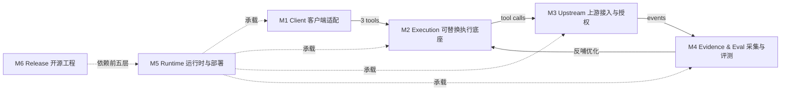
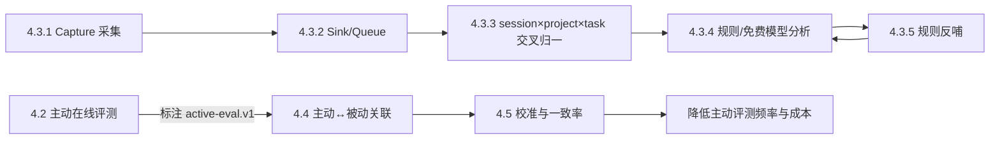

# ARCHITECTURE-INDEX — 唯一渐进式架构主目录

> **治理标记**：`[云端总控]` 收口版本（2026-11-25；本版同步 PR #26 入站审批口令与 PR #29 上游鉴权切换）。
> **权威顺序**：[FRAMEWORK.md](FRAMEWORK.md)（用户原文与最高意图）→ [FRAMEWORK-FULL.md](FRAMEWORK-FULL.md)（目标态 S0–S5）→ **本文（唯一渐进式架构主目录）** → [MODULE-DECOMPOSITION.md](MODULE-DECOMPOSITION.md)（L2→L3 工作包派发）→ 审计报告。
> **阅读方式（渐进式披露）**：**L0** 一屏看全景与不变量 → **L1** 看六模块边界与依赖红线 → **L2** 按需展开到子模块与细粒度组件（附局部横向闭环图）→ **L3** 落位到代码路径、活跃缺口与工作包。
> **已收口文档**：原 `ARCHITECTURE.md`、`ARCHITECTURE-PROGRESSIVE.md` 核心内容已并入本文；`architecture-graph.json` 已冻结为实验性快照（不再手工双写）。
> **动态实况雷达（高变动状态）**：逐客户端/逐上游真实可用矩阵、四态落差与 Top 3 优先打点见 [STATUS.md](STATUS.md)（本文仅保持静态架构骨架）。

---

## 状态图例

| 状态 | 含义 |
|---|---|
| `L0` | 设计/文档，无实现 |
| `L1` | 原型/离线测试，未接生产 |
| `L2` | 已集成或 flag-gated，可局部使用 |
| `L3` | 真实客户端 / 真实上游 / 真实写入验证通过 |
| `L4` | 多租户 / 生产级 SLA（本项目非目标） |

**硬规则：测试绿 ≠ L3；L3 必须有真实客户端/真实上游/真实写入证据。**

---

# L0 · 一屏全景与核心不变量

> 一句话：**面向网页端非代码模式 AI 客户端的单 owner、可自托管 MCP 网关**——对外永远只暴露 3 个稳定工具（`search` / `execute_read` / `execute`），内部用可替换执行底座消化多步编排与上游大载荷，用“离线 + 主动线上 + 被动线上”评测闭环持续验证与反哺。

### 六模块主链路与横向关系

### 十条核心不变量

1. **三工具稳定面**：对外永远只有 `search` / `execute_read` / `execute`，名称与顺序不变。
2. **工具面会话冻结**：Gemini 不消费 `notifications/tools/list_changed`，改 schema 必须走版本路径（如 `/mcp/v2`）。
3. **读写强隔离**：`execute_read` 拒绝写操作；`execute` 写操作必须走 `dryRun` / host `approve` 与原子写路径，guest 不可自授权。
4. **纯正文返回**：文件读取 `content` 必须是纯正文，SHA 与下载提示只放独立元数据。
5. **PR 编号 URL 优先**：PR `number` 严格从 URL `/pull/(\d+)` 提取，永不用内部 `id`/`nodeId` 兜底。
6. **禁止静默截断**：任何截断必须附带字段级元数据（field / total / tail / next）。
7. **网关独立授权 + 入站最小暴露**：绝不与外部宿主（如 DSH）共享 rotating refresh token；v2 KV key 按 `gmcgw:v2:grant:<env>:<owner>:<server>` 隔离。入站 `/oauth/authorize` 必须过 owner 审批口令（`OAUTH_APPROVE_PASSPHRASE`，常量时间比较，错误/缺失 403 且不落 code）；DCR 默认关闭，只有显式 `ALLOW_DCR_FOR_CHATGPT`/`ALLOW_DCR_FOR_CLAUDE` carve-out 才开放；`/upstream/oauth/start` 由 `UPSTREAM_OAUTH_ADMIN_KEY` 保护。
8. **采集与安全分离**：capture 保持 full-fidelity 不做隐私过滤；模型可见错误必须对 token/secret 脱敏。
9. **失败不留半成品**：多文件写优先原子提交（`push_files`）；非原子失败必须返回 `partial:true` 与补偿提示。
10. **证据优先于测试数**：单测绿灯或 fake harness 通过只代表代码候选，不等于 V0 验收通过。

### 当前基线快照

| 指标 | 当前状态 |
|---|---|
| 生产部署 | `f2002d9`（2026-11-25 01:55 手动 `vercel --prod`；`buildHash=3b1a0772…`；`deploymentId=dpl_6P2Ww8vsTHXbbSF98GTE55HKitB4`）；`main=cd23fdc`（PR #28 已合、未部署） |
| 全量测试基线 | `1583 tests / 1577 pass / 0 fail / 6 todo`（2026-11-25 lead 实跑；docs 分支基于 main cd23fdc，勿引用 PR/子代理数字） |
| 上游在线实况（`f2002d9` 实测） | GitHub 42 / Linear 27 / Vercel 73 / Figma 47 tools 在线；**Notion 0（offline，PR #31 未合并）** |
| 模块物理目录 | `src/` 已拆分为 6 目录（根目录保留兼容 shim） |
| 模块边界门禁 | `0 new violations`；9 条 legacy 边待清 |
| V0 验收 | **NOT ACCEPTED**（A 门当前构建可追溯，B–G 未过） |
| 上游授权门禁 | [AUTH-READY.md](AUTH-READY.md) = **NOT READY**（Linear 生产只读已验证；Notion 授权已存但 runtime offline） |
| OSS 公开状态 | 未公开（仅本地 staging / release 产物） |

---

# L1 · 六模块卡片与依赖红线

| 模块 | 一句话职责 | 核心接口 | 代码目录 | 当前成熟度 | 不负责 |
|---|---|---|---|---|---|
| **M1 Client** | 把不同 Web 非代码客户端适配成同一套 3 工具契约 | `ClientAdapter` | `src/client/` | L0–L2 | 业务编排、上游连接 |
| **M2 Execution** | 3 工具 + 可替换执行器 + 沙箱 + 规范化与写安全闸 | `ExecutionAdapter` | `src/execution/` | L0–L3 | OAuth、上游生命周期 |
| **M3 Upstream** | 连接真实 MCP、独立 grant 授权、目录与写事务 | `UpstreamAdapter` | `src/upstream/` | L0–L2（Linear 只读生产已验证；Notion runtime 未通） | 客户端编码 |
| **M4 Evidence & Eval** | full-fidelity 采集、主动/被动评测与校准反哺 | `EvalHarness` | `src/evidence/` + `scripts/` | L0–L2 | 生产执行 |
| **M5 Runtime** | HTTP 入口、配置、KV/R2、健康检查与手动部署 | `RuntimeAdapter` | `src/runtime/` + `src/shared/` | L0–L3 | 业务编排 |
| **M6 Release** | allowlist 导出、安全中立化、模板与开源治理 | `ReleaseAdapter` | `scripts/export-oss.mjs` + `docs/OPEN-SOURCE/` | L0–L2 | 运行时能力 |

### 依赖红线

- 禁止 `M1 Client` 直接依赖 `M3 Upstream`；
- 禁止 `M3 Upstream` 反向依赖 `M1 Client`；
- 禁止 `M4 Evidence & Eval` 反向控制生产执行；
- 禁止 `M6 Release` 进入核心运行时；
- 跨模块只通过接口与数据契约通信，不共享隐式全局状态。

---

# L2 · 六模块细粒度展开（渐进式目录）

## M1 · Client（客户端适配）

主战场为**网页端非代码模式**（Gemini / ChatGPT / Claude 等）；逐平台走 `接入 → 测试 → 优化 → 评测 → 回归`。

| 子模块 | 细粒度职责 | 设计文档 | 代码落位 | 成熟度 | 当前缺口 |
|---|---|---|---|---|---|
| **1.1 Registry** | 平台 / 模式 / 计划 / 能力注册 | [FRAMEWORK.md](FRAMEWORK.md) | 未实现 | L0 | 能力注册表 |
| **1.2 ModeResolver** | 识别网页非代码模式 vs 代码模式与 fallback | [FRAMEWORK.md](FRAMEWORK.md) §11/13 | `src/client/client-platform.js`（部分） | L0–L1 | web-non-code 检测 |
| **1.3 AuthAdapter** | 入站 OAuth / DCR（默认关、仅显式 carve-out）/ CIMD / locked client / origin 一致性 / owner 审批口令 | [CONTRACT.md](../CONTRACT.md)、[AUTH-READY.md](AUTH-READY.md) | `src/client/oauth.js` | L2 | 真实客户端带口令回归；Client Registry（Issue #27） |
| **1.4 Profile** | schema / `structuredContent` / text JSON / annotations 编码 | [FRAMEWORK.md](FRAMEWORK.md) | `src/client/client-profile.js`、`src/shared/sanitize.js` | L2 | 真实窗口编码验收 |
| **1.5 Onboarding** | 首次使用引导（部署 → 上游授权 → 客户端连接） | [FRAMEWORK.md](FRAMEWORK.md) | 文档 | L0 | 引导向导 |
| **1.6 Approval** | 客户端权限优先；annotations 实验 profile（B+D） | [FRAMEWORK.md](FRAMEWORK.md) §14 | `src/client/client-profile.js` | L1 | Gemini 真实弹窗实验 |

## M2 · Execution（可替换执行底座）

执行底座按客户端能力替换（而非全局唯一）：Gemini 优先 Typed Plan（待 A/B 验证后切换）、强模型默认 Code Mode、宿主支持 tool search 时可扩展 Native / Hybrid。

| 子模块 | 细粒度职责 | 设计文档 | 代码落位 | 成熟度 | 当前缺口 |
|---|---|---|---|---|---|
| **2.1 Router** | 按客户端 profile / 任务选择执行器 | [FRAMEWORK-FULL.md](FRAMEWORK-FULL.md) | 未实现 | L0 | 路由层未建 |
| **2.2 CodeMode** | QuickJS 自由 JS 沙箱、渐进 `search`、批量编排 | [FRAMEWORK.md](FRAMEWORK.md) | `src/execution/codemode.js`、`codemode-util.js` | L3（生产默认） | 真实客户端任务验收 |
| **2.3 TypedPlan** | `/mcp/v2`（`ENABLE_MCP_V2=1`）类型化步骤执行 | [eval/TYPED-PLAN-TEST-PLAN.md](eval/TYPED-PLAN-TEST-PLAN.md) | `src/execution/typed-plan.js`、`codemode-v2.js` | L2（flag） | 真实模型 A/B |
| **2.4 Native / Hybrid** | 宿主原生工具搜索 / plan+code 混合回退 | [FRAMEWORK-FULL.md](FRAMEWORK-FULL.md) | 未实现 | L0 | 原型未建 |
| **2.5 ContextBudget** | 字段级截断元数据、续读、摘要与结果预算 | [FRAMEWORK.md](FRAMEWORK.md) §13.4 | `src/execution/codemode.js`（部分） | L1 | 顶层键字节/行数清单（OF-7） |
| **2.6 ResultLifecycle** | raw → canonical（纯正文 / URL-first PR number）→ profile 编码 | [FRAMEWORK.md](FRAMEWORK.md) | `src/execution/result-normalize.js`、`tool-format.js` | L2 | Issue 创建幂等回查（OF-1）、`fileResult.path`（#4） |
| **2.7 WriteGuard** | `dryRun` / host `approve` / 截断读拒写 / 原子写 / 写前预检 | [FRAMEWORK.md](FRAMEWORK.md) | `src/execution/file-write.js`、`github-helpers.js` | L2 | TS/TSX 语法预检（OF-4）、局部补丁契约（OF-6） |

## M3 · Upstream（上游接入与授权）

当前覆盖 GitHub / Notion / Linear / Vercel / Figma；后续候选 Cloudflare / Gmail / Firecrawl / Exa / Tavily。**授权体验排第一位**。
（`f2002d9` 实测：GitHub/Linear/Vercel/Figma 在线，Notion 因 runtime 未注入 Authorization 而 offline；PR #31 修复中。）

| 子模块 | 细粒度职责 | 设计文档 | 代码落位 | 成熟度 | 当前缺口 |
|---|---|---|---|---|---|
| **3.1 Registry** | 上游清单、传输协议、allow/deny 策略与固定 SOP | [FRAMEWORK.md](FRAMEWORK.md) §5 | `src/upstream/upstreams.js`、`src/shared/catalog.js` | L2 | 标准化上游 SOP 模板 |
| **3.2 ProviderAdapter** | 各上游参数别名（如 `branch→ref`）与特殊防护 | [eval/AUTH-PROVIDERS.md](eval/AUTH-PROVIDERS.md) | `src/upstream/upstreams.js`、`figma-guard.js` | L2 | Notion runtime offline（PR #31）；Vercel 真实 401/工具清单未验 |
| **3.3 GrantBroker** | `owner` 标记、v2 KV key、Linear `static_bearer` PAT、Notion 网关 OAuth/DCR、Vercel CIMD | [AUTH-READY.md](AUTH-READY.md) | `src/upstream/upstream-auth.js`、`upstream-oauth.js`、`upstreams.js` | L2（Linear 生产已验证；Notion grant 已存、runtime 未通） | Notion runtime 注入（PR #31）、8h/72h 生命周期、KV 环境隔离、旧凭据清理 |
| **3.4 Canonical** | 统一 file / PR / issue / actions 返回结构 | [FRAMEWORK.md](FRAMEWORK.md) | `src/execution/result-normalize.js` | L2 | 真实生产形状复验（OF-2） |
| **3.5 WriteTransaction** | patch / `push_files` 原子提交 / PR / CI 等待与重试 | [eval/ONLINE-FEEDBACK-2026-11-24-PR80-101.md](eval/ONLINE-FEEDBACK-2026-11-24-PR80-101.md) | `src/execution/file-write.js`、`github-helpers.js` | L2 | `rerunFailedJobs`（OF-5）、delete/rename（OF-8） |
| **3.6 Health & Quota** | 上游健康探针；Firecrawl/Exa 等搜索 API 去重与查询预算 | [FRAMEWORK.md](FRAMEWORK.md) §13.5 | 部分 | L0–L1 | 限流与配额优化未实现 |

## M4 · Evidence & Eval（采集与评测闭环）

评的是**工具级可核验真值**（参数契约、返回 schema、上游副作用、重放一致性），不是主观模型推理。核心机制是**主动反哺被动**，逐步降低主动评测频率与成本。

| 子模块 / 组件 | 细粒度职责 | 设计文档 | 代码落位 | 成熟度 | 当前缺口 |
|---|---|---|---|---|---|
| **4.1 Offline 离线基准** | 官方逐工具契约 + 权威任务集（L1 / G6 / N1–N9 / J1–J6） | [EVALUATION.md](EVALUATION.md) | `explore/tasks-*`、`scripts/run-l1-smoke.mjs` | L1–L2 | 官方逐工具全覆盖、online-gap baseline 冻结 |
| **4.2 ActiveOnline 主动在线** | 真人在真实客户端提问、`active-eval.v1` 标注与任务指纹 | [eval/ONLINE-FEEDBACK.md](eval/ONLINE-FEEDBACK.md) | `scripts/record-online-feedback.mjs` | L1 | `active-eval.v1` 记录器（E1） |
| **4.3.1 Capture 采集层** | full-fidelity 请求/响应信封采集 | [EVALUATION.md](EVALUATION.md) | `src/evidence/capture.js` | L2 | 补 `taskId` / `clientMode`（E2）、内部上游调用逐次计数 |
| **4.3.2 Sink / Queue** | 文件 / R2 / HTTP 异步队列与 LRU 背压 | [EVALUATION.md](EVALUATION.md) | `src/evidence/capture-queue.js` | L2 | R2 分页/截断修复已合入 main（#28，`scripts/capture-digest.mjs`），**真实窗口复验未做** |
| **4.3.3 Cross-Join 交叉归一** | `session × project × task × request` 交叉归因 | [MODULE-DECOMPOSITION.md](MODULE-DECOMPOSITION.md) | `src/evidence/project-tag.js` | L1 | 缺 `taskId` 串联（E2） |
| **4.3.4 Analysis 分析层** | 契约/截断规则检查 + 免费模型 advisory 假设（非结论） | [AGENTS.md](../AGENTS.md) §1 | `scripts/analyze-captures.mjs` | L1 | 确定性被动检查器（E4） |
| **4.4 Link 主动↔被动关联** | exact / likely / weak / unmatched 自动对齐 | [eval/ACTIVE-PASSIVE-CORRELATION.md](eval/ACTIVE-PASSIVE-CORRELATION.md) | 未实现 | L0 | `link-active-passive`（E3） |
| **4.5 Calibration 校准反哺** | 用主动标签度量被动规则 precision/recall 并反哺规则 | [MODULE-DECOMPOSITION.md](MODULE-DECOMPOSITION.md) | 未实现 | L0 | 校准脚本（E5） |
| **4.6 Orchestrator 编排** | `eval-cycle`、回放、baseline 对照与 scorecard | [eval/CONTINUOUS-EVAL.md](eval/CONTINUOUS-EVAL.md) | `scripts/eval-cycle.mjs`、`replay-online-session.mjs` | L1 | 真实数据基线与双构建同任务对照（E6） |

## M5 · Runtime（运行时与部署）

原则：**默认部署路径无意外扣费风险**；生产关闭自动发布，手动 promote 并核对 `/healthz` 的 `commit`/`buildHash`。

| 子模块 | 细粒度职责 | 设计文档 | 代码落位 | 成熟度 | 当前缺口 |
|---|---|---|---|---|---|
| **5.1 HTTP 入口** | Vercel Serverless / 本地 Node HTTP 双入口 | [DEPLOY.md](../DEPLOY.md) | `api/index.js`、`src/runtime/vercel-app.js`、`server.js` | L3 | — |
| **5.2 Config / Store** | 环境变量校验、KV / Redis / 文件存储、构建信息 | [DEPLOY.md](../DEPLOY.md) | `src/shared/config.js`、`store.js`、`build-info.js` | L2 | 真实 preview/prod KV 隔离实测 |
| **5.3 Health & Deploy** | `/healthz`、手动部署台账、回滚策略 | [DEPLOY-POLICY.md](DEPLOY-POLICY.md)、[DEPLOYMENTS.md](DEPLOYMENTS.md) | `vercel.json`、`scripts/write-build-info.mjs` | L2 | 自动化回滚演练 |
| **5.4 Docker / 多载体** | Docker 自托管、内网穿透、免费 PaaS RuntimeAdapter | [FRAMEWORK.md](FRAMEWORK.md) §6 | `Dockerfile`、`docker-compose.yml` | L0–L1 | Docker build / `npm audit` 未实跑；RuntimeAdapter / CostGuard 未建 |

## M6 · Release（开源工程）

优先级后置，强依赖前五层真实可用性验收；未获明确批准不公开、不建远端、不 push。

| 子模块 | 细粒度职责 | 设计文档 | 代码落位 | 成熟度 | 当前缺口 |
|---|---|---|---|---|---|
| **6.1 Export & Safety** | allowlist 导出、身份/路径中立化、密钥与泄露扫描 | [OPEN-SOURCE/PUBLIC-SAFETY-AUDIT.md](OPEN-SOURCE/PUBLIC-SAFETY-AUDIT.md) | `scripts/export-oss.mjs`、`prepare-neutral-source.mjs` | L2 | 文档残留核查 |
| **6.2 Templates & Docs** | 客户端/上游/部署引导模板、README 指标一致性 | [OPEN-SOURCE/RELEASE-LOCAL.md](OPEN-SOURCE/RELEASE-LOCAL.md) | `templates/`、`README*.md` | L1 | README 过期数字清理 |
| **6.3 Governance** | 许可证、安全披露、贡献流程与发布门禁 | [OPEN-SOURCE/FINAL-HEALTH-AUDIT.md](OPEN-SOURCE/FINAL-HEALTH-AUDIT.md) | `SECURITY.md`、`CONTRIBUTING.md` | L0–L1 | 发布前人工核对清单 |

---

# L3 · 活跃缺口、文件定位与工作包入口

### 1. 活跃 P0 缺口（阻塞 V0 验收或证据链）

| ID | 缺口 | 所属模块 | 对应验收/工作包 |
|---|---|---|---|
| **GAP-A** | 真实 Gemini / ChatGPT / Claude 窗口任务未验收 | M1 / M2 | V0 验收门 B |
| **GAP-B** | 真实写回环（含 CI 读取）与当前生产复验未闭环 | M2 / M3 | V0 验收门 C / `OF-2` |
| **GAP-C** | 网关独立授权主体已切换（Linear `static_bearer` PAT、Notion `owner=gateway`），但 Notion runtime offline（PR #31）、8h/72h 未观测、旧凭据未清理、KV 环境隔离未实测 | M3 / M5 | V0 验收门 D / [AUTH-READY.md](AUTH-READY.md) §1.6、§1.9 |
| **GAP-D** | 被动采集 R2 分页/截断修复已合入 main（`#28`），但真实窗口复验与 `taskId`/`clientMode` 补字段仍未完成 | M4 | `OF-3` / `E2` |
| **GAP-E** | 主动↔被动关联与校准反哺未实现 | M4 | `E1` / `E3` / `E5` |
| **GAP-F** | 建 Issue 缺少幂等与回查（重复/空 number） | M2 / M3 | `OF-1` |
| **GAP-G** | 真实上游 401 脱敏实测、Docker build、`npm audit` 未跑 | M5 / 安全 | V0 验收门 F |
| **GAP-H** | OSS 发布前文档口径与门禁未过 | M6 | 暂缓，依赖前五层 |
| **GAP-I** | 入站客户端接入分裂：生产同时存在预注册 client 与 DCR，统一 Client Registry（Issue #27）未实现 | M1 / M3 | M6 开源前 P0/P1 / [AUTH-READY.md](AUTH-READY.md) §2 |

### 2. 快速定位表

| 你想查 / 你想做 | 直达文档 |
|---|---|
| 用户原文、六模块口径、审批原则 | [FRAMEWORK.md](FRAMEWORK.md) |
| 目标态与 S0–S5 演进路线 | [FRAMEWORK-FULL.md](FRAMEWORK-FULL.md) |
| 把组件拆成可并行工作包（写作用域 + DAG） | [MODULE-DECOMPOSITION.md](MODULE-DECOMPOSITION.md) |
| 仓库文件归属与物理迁移规范 | [REPO-MAP.md](REPO-MAP.md)、[REPO-STORAGE-PLAN.md](REPO-STORAGE-PLAN.md) |
| V0 真实验收门（A–G） | [ACCEPTANCE.md](ACCEPTANCE.md) |
| 何时能向用户发起上游授权（唯一门禁） | [AUTH-READY.md](AUTH-READY.md) |
| 上游授权现状、入站审批口令、旧凭据清理排期 | [AUTH-READY.md](AUTH-READY.md) §1.3/§1.6/§1.9 |
| 入站 Client Registry 与 DCR 收口（Issue #27） | [MODULE-DECOMPOSITION.md](MODULE-DECOMPOSITION.md) §3 |
| 最新线上反馈与被动 scorecard 对照 | [eval/ONLINE-FEEDBACK-2026-11-24-PR80-101.md](eval/ONLINE-FEEDBACK-2026-11-24-PR80-101.md) |
| 部署纪律与生产部署日志 | [DEPLOY-POLICY.md](DEPLOY-POLICY.md)、[DEPLOYMENTS.md](DEPLOYMENTS.md) |
| 全仓库审计与安全审计 | [architecture-audit/FULL-REPO-FINDINGS.md](architecture-audit/FULL-REPO-FINDINGS.md)、[eval/CODEMODE-SECURITY-AUDIT.md](eval/CODEMODE-SECURITY-AUDIT.md) |

### 3. 维护规则

- 架构与模块边界变化只维护本文与 [FRAMEWORK.md](FRAMEWORK.md)，不再多头同步；
- 新增子模块或工作包先在本文 L2/L3 落位，再到 [MODULE-DECOMPOSITION.md](MODULE-DECOMPOSITION.md) 拆写作用域与验收；
- 缺口关闭必须附真实命令/证据或 `requestId`，不得仅凭单测通过划掉 L3 缺口。
