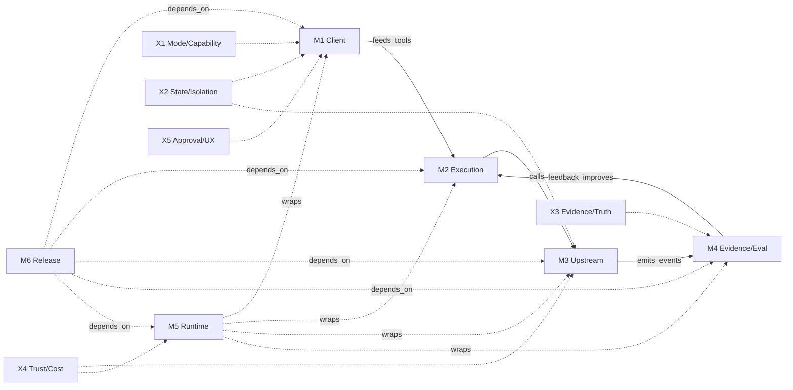
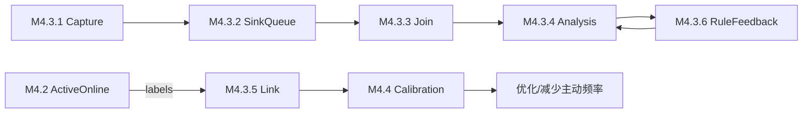

# ARCHITECTURE-INDEX — 全项目架构细化目录

> 用途：一个入口定位“某个模块/子模块/细小实现”在：
> 设计文档 → 代码 → 测试 → 成熟度 → 缺口 → 下一步工作包。
>
> 状态锚点：2026-11-24。
> 权威顺序：`FRAMEWORK.md` → `FRAMEWORK-FULL.md` → 本文 → 审计报告。
> 本文是目录，不替代设计文档。

---

## 0. 这不是书籍目录，是图谱

本文件不是“章节一、章节二”的线性目录，而是**节点 + 边**的图谱入口。

机器可读图谱：

**[architecture-graph.json](architecture-graph.json)**

### 0.0.1 节点类型

| 类型 | 例子 | 用途 |
|---|---|---|
| `module` | `M4` Evidence & Eval | 六大模块 |
| `submodule` | `M4.3` PassiveOnline | 能力边界 |
| `component` | `M4.3.1` Capture | 可独立设计/测试 |
| `crosscut` | `X2` StateIsolation | 横切平面 |
| `workpackage` | `WP-E3` active-passive link | 可分配工作包 |
| `gap` | `GAP-E` | 缺口/阻塞 |

### 0.0.2 边类型

| 边 | 含义 |
|---|---|
| `feeds_tools` | 客户端把 3 工具喂给执行层 |
| `calls` | 执行层调用上游 |
| `emits_events` | 上游/执行产生 capture 事件 |
| `feedback_improves` | 评测反哺执行 |
| `wraps` | 运行时包裹所有模块 |
| `depends_on` | 开源依赖前五层 |
| `selects` | 路由器选择执行器 |
| `constrains` | 上下文预算约束执行 |
| `labels` | 主动评测标注被动数据 |
| `calibrates` | 主动标签校准被动规则 |
| `blocks` | 缺口阻塞节点 |
| `implements` | 工作包实现节点 |
| `crosses` | 横切平面横跨模块 |

### 0.0.3 主图谱



### 0.0.4 评测子图（示例）



这条子图说明：

- 主动不是孤立，它给被动提供标签；
- 被动不是孤立，它通过采集→归一→分析→规则反哺；
- 校准是连接点，不是报告终点；
- 优化才是终点。

### 0.0.5 查询方式

| 想找 | 从哪个节点进 |
|---|---|
| 客户端模式/profile | `M1.2` / `M1.4` |
| 执行器选择 | `M2.1` |
| Code Mode | `M2.2` |
| 写路径 | `M2.8` / `M3.5` |
| 上游授权 | `M3.3` |
| 被动采集 | `M4.3.1` → `M4.3.2` |
| 主动↔被动 | `M4.2` → `M4.3.5` → `M4.4` |
| 运行时/部署 | `M5.1` / `M5.6` |
| 开源门槛 | `M6` |
| 缺口 | `GAP-*` |
| 工作包 | `WP-E*` |

### 0.0.6 下面表格怎么读

- §1–§7 是**节点清单/成熟度**，不是章节顺序；
- 先按图谱定位节点，再查表格；
- 代码、测试、文档、缺口、工作包都挂在节点上；
- 新增设计先加节点/边，再写代码。

---

## 0.1 状态图例

| 状态 | 含义 |
|---|---|
| L0 | 设计/文档，无实现 |
| L1 | 原型/离线测试，不接生产 |
| L2 | 已集成/flag-gated，可局部用 |
| L3 | 真实客户端/真实上游/真实写验证过 |
| L4 | 生产级/多租户/SLA（本项目非目标） |

**测试绿 ≠ L3。L3 必须有真实证据。**

---

## 1. 项目总览

```text
Web 非代码客户端
  → 3 tools
  → 可替换执行底座
  → 多上游
  → capture/eval 闭环
  → 多载体运行
  → 开源
```

当前一句话：

> 代码原型强、测试多、架构清楚；真实客户端/真实写/真实授权仍未验收；开源 L1 未达。

| 指标 | 当前 |
|---|---|
| main HEAD | `efcf2f0`（文档） |
| 生产 | `1481408` |
| 全量测试 | 1461 / 1455 pass / 0 fail / 6 todo |
| 模块边界 | 0 new violations；9 legacy edges |
| V0 验收 | NOT ACCEPTED（A PARTIAL，B–G 未过） |
| 冻结点 | architecture / p0-fixes / modules |

---

## 2. 文档地图

### 总纲/目标

- [FRAMEWORK.md](FRAMEWORK.md) — 用户原文 + 六模块 + 纠正 + 关联机制
- [FRAMEWORK-FULL.md](FRAMEWORK-FULL.md) — 完全态 + S0–S5
- [MODULE-DECOMPOSITION.md](MODULE-DECOMPOSITION.md) — 模块→子模块→组件→工作包
- [ARCHITECTURE.md](ARCHITECTURE.md) / [ARCHITECTURE-PROGRESSIVE.md](ARCHITECTURE-PROGRESSIVE.md) — 结构参考
- [REPO-MAP.md](REPO-MAP.md) / [REPO-STORAGE-PLAN.md](REPO-STORAGE-PLAN.md) — 文件/模块/迁移
- [ACCEPTANCE.md](ACCEPTANCE.md) — V0 验收门
- [EVALUATION.md](EVALUATION.md) — 评测架构
- [AUTH-READY.md](AUTH-READY.md) — 授权门禁
- [DEPLOY-POLICY.md](DEPLOY-POLICY.md) / [DEPLOYMENTS.md](DEPLOYMENTS.md)

### 审计

- [architecture-audit/00-crosscut.md](architecture-audit/00-crosscut.md) — 跨模块
- [architecture-audit/01-client.md](architecture-audit/01-client.md) … 06-oss
- [architecture-audit/FULL-REPO-FINDINGS.md](architecture-audit/FULL-REPO-FINDINGS.md)
- [OPEN-SOURCE/INDEPENDENT-REVIEW-2026-11-24.md](OPEN-SOURCE/INDEPENDENT-REVIEW-2026-11-24.md)
- [OPEN-SOURCE/RESIDUAL-RISK-AUDIT.md](OPEN-SOURCE/RESIDUAL-RISK-AUDIT.md)
- [OPEN-SOURCE/FINAL-HEALTH-AUDIT.md](OPEN-SOURCE/FINAL-HEALTH-AUDIT.md)

---

## 3. 代码地图

### 入口/运行时

| 内容 | 路径 |
|---|---|
| Vercel entry | `api/index.js` |
| Vercel app | `src/runtime/vercel-app.js` |
| Node server | `src/runtime/server.js` |
| Store | `src/shared/store.js` |
| Config | `src/shared/config.js` |
| Build info | `src/shared/build-info.js` |

### 客户端

| 内容 | 路径 |
|---|---|
| 平台识别 | `src/client/client-platform.js` |
| profile/编码/annotations | `src/client/client-profile.js` |
| OAuth/DCR/CIMD | `src/client/oauth.js` |
| schema sanitize | `src/shared/sanitize.js` |

### 执行

| 内容 | 路径 |
|---|---|
| Code Mode | `src/execution/codemode.js` |
| v2 plan/code | `src/execution/codemode-v2.js` |
| Typed Plan | `src/execution/typed-plan.js` |
| tool 描述/错误 | `src/execution/tool-format.js` |
| canonical | `src/execution/result-normalize.js` |
| patch/write | `src/execution/file-write.js` |
| GitHub helper | `src/execution/github-helpers.js` |
| catalog | `src/shared/catalog.js` |

### 上游

| 内容 | 路径 |
|---|---|
| 连接/调用 | `src/upstream/upstreams.js` |
| grant/refresh | `src/upstream/upstream-auth.js` |
| DCR/CIMD | `src/upstream/upstream-oauth.js` |
| Figma guard | `src/upstream/figma-guard.js` |

### 证据

| 内容 | 路径 |
|---|---|
| capture | `src/evidence/capture.js` |
| queue | `src/evidence/capture-queue.js` |
| project tag | `src/evidence/project-tag.js` |

### 评测/脚本

| 内容 | 路径 |
|---|---|
| L1 runner | `scripts/run-l1-smoke.mjs` |
| replay | `scripts/replay-online-session.mjs` |
| eval cycle | `scripts/eval-cycle.mjs` |
| online feedback | `scripts/record-online-feedback.mjs` |
| link（设计） | 未实现 |
| 官方任务 | `explore/tasks-*` |

### 仓库门禁

| 内容 | 路径 |
|---|---|
| 模块边界 | `scripts/check-module-boundaries.mjs` |
| 截断审计 | `scripts/audit-truncation.mjs` |
| OSS export | `scripts/export-oss.mjs` |
| CI | `.github/workflows/ci.yml` |

---

## 4. 六模块细化与成熟度

### 模块 1：Client

| 子模块 | 设计 | 代码 | 测试 | 成熟度 | 缺口 |
|---|---|---|---|---|---|
| Registry | FRAMEWORK | 未实现 | — | L0 | 平台/模式/计划/能力注册 |
| ModeResolver | FRAMEWORK §11/13 | 未实现 | — | L0 | web-non-code 检测/fallback |
| AuthAdapter | CLIENTS/AUTH | oauth.js | 部分 | L2 | 真实客户端 |
| Profile | ARCHITECTURE | client-profile.js | 21 conformance | L2 | 真实编码 |
| Onboarding | FRAMEWORK | 文档 | — | L0 | 向导 |
| Approval | FRAMEWORK §14 | annotations | 部分 | L1 | 实验 profile B+D |

当前：L0–L2；真实 Gemini/ChatGPT/Claude 未验收。

### 模块 2：Execution

| 子模块 | 设计 | 代码 | 测试 | 成熟度 | 缺口 |
|---|---|---|---|---|---|
| CodeMode | FRAMEWORK | codemode.js | 强 | L3（生产默认） | 真实客户端 |
| TypedPlan | TYPED-PLAN | typed-plan.js | 强 | L2（flag） | 默认/真实 A/B |
| Router | FULL | 未实现 | — | L0 | 按客户端选 |
| Native/Hybrid | FULL | 未实现 | — | L0 | 原型 |
| ContextBudget | FULL | 部分 | 部分 | L1 | 策略化 |
| ResultLifecycle | 文档 | code | 强 | L2 | 真实 profile |
| WriteGuard | 文档 | code | 强 | L2 | 真实写 |

### 模块 3：Upstream

| 子模块 | 设计 | 代码 | 测试 | 成熟度 | 缺口 |
|---|---|---|---|---|---|
| Registry | UPSTREAMS | upstreams.js | 部分 | L2 | SOP/模板 |
| Provider | AUTH-PROVIDERS | 5 上游 | 3/5 real tools | L2 | Notion/Vercel 401 |
| GrantBroker | AUTH | auth/oauth | 强 fake | L2 | 真实 owner 迁移/KV |
| Canonical | 文档 | result-normalize | 强 | L2 | 真实形状 |
| WriteTransaction | 文档 | file-write | 强 | L2 | 真实写回环 |
| Health | 文档 | 部分 | 部分 | L1 | 上游健康 |
| Quota | FRAMEWORK | 未实现 | — | L0 | Firecrawl/Exa |

### 模块 4：Evidence & Eval

| 子模块 | 设计 | 代码 | 测试 | 成熟度 | 缺口 |
|---|---|---|---|---|---|
| Offline | EVALUATION | L1 | 部分 | L1–L2 | 官方全覆盖 |
| Active online | FRAMEWORK §13 | 记录 schema | 部分 | L1 | link/标注 |
| Passive capture | EVALUATION | capture* | 强 | L2 | taskId |
| Join | MODULE-DECOMP | 部分 | 部分 | L1 | taskId |
| Analysis | EVALUATION | scripts | 部分 | L1 | 免费模型 advisory |
| Link | ACTIVE-PASSIVE | 未实现 | — | L0 | E3 |
| Calibration | 文档 | 未实现 | — | L0 | E5 |
| Cycle | CONTINUOUS-EVAL | eval-cycle | 19 | L1 | 真实数据 |

### 模块 5：Runtime

| 子模块 | 设计 | 代码 | 测试 | 成熟度 | 缺口 |
|---|---|---|---|---|---|
| HTTP | 文档 | vercel/server | 强 | L3 | — |
| Config | 文档 | config | 强 | L2 | fail-fast |
| Store | 文档 | store | 强 | L2 | 真实 KV |
| Sink | 文档 | capture | 强 | L2 | 真实 R2 |
| Health | 文档 | healthz | 强 | L2 | 上游健康 |
| Deploy | DEPLOY | vercel.json | — | L2 | 手动 promote/回滚 |
| CostGuard | FRAMEWORK | 未实现 | — | L0 | 免费额度 |
| RuntimeAdapter | FULL | 未实现 | — | L0 | 多载体 |
| Docker | DOCKER | scaffold | NOT-RUN | L1 | 实跑 |

### 模块 6：Release

| 子模块 | 设计 | 代码 | 测试 | 成熟度 | 缺口 |
|---|---|---|---|---|---|
| Export | OSS | export-oss | 强 | L2 | 发布 |
| Safety | AUDIT | neutralizer | 强 | L2 | 文档残留 |
| Templates | OSS | templates | 部分 | L1 | 可部署 |
| Docs | OSS | docs | 部分 | L1 | 旧数字 |
| Governance | READINESS | 部分 | — | L0 | LICENSE/安全/贡献 |
| Release | READINESS | 本地 repo | — | L1 | 未公开 |

---

## 5. 当前缺口登记

### P0（阻塞真实可用/发布）

| ID | 缺口 | 状态 |
|---|---|---|
| A | 真实 Gemini/ChatGPT/Claude 任务 | 未做 |
| B | 真实写回环 | 未做 |
| C | 网关独立授权/owner 迁移 | 未做 |
| D | 多客户端隔离 + taskId | 未做 |
| E | active/passive 字段与 link | 未做 |
| F | Docker/npm audit | NOT-RUN |
| G | OSS L1 | 未过 |

### P1（架构完整度）

| ID | 缺口 | 状态 |
|---|---|---|
| H | Native/Hybrid | L0 |
| I | ExecutionRouter | L0 |
| J | RuntimeAdapter | L0 |
| K | 免费平台/CostGuard | L0 |
| L | 官方逐工具全覆盖 | 部分 |
| M | calibration | L0 |
| N | 并发调度 | 未实现 |
| O | 审批实验 profile | 未实现 |

### 已修（代码层）

- G-03 v2 plan IO；
- G-04 allow/deny；
- G-05 commitSha；
- G-07 capture options；
- G-13 queue LRU。

### 遗留

- 9 条 legacy 依赖边；
- 25 个旧路径 shim（物理迁移已做，shim 待删）；
- tests/scripts/docs 物理迁移未做。

---

## 6. 定位表：想找什么去哪

| 想定位 | 看 |
|---|---|
| 产品目标/六模块 | FRAMEWORK.md |
| 完全态 | FRAMEWORK-FULL.md |
| 模块→工作包 | MODULE-DECOMPOSITION.md |
| 文件属于哪个模块 | REPO-MAP.md |
| 为什么这样存储 | REPO-STORAGE-PLAN.md |
| 客户端差异 | CLIENT-PROFILES/CLIENTS |
| 授权 | AUTH-READY/AUTH-PROVIDERS/FRAMEWORK-FULL §Upstream |
| 评测闭环 | EVALUATION/ACTIVE-PASSIVE-CORRELATION |
| 验收门 | ACCEPTANCE |
| 当前部署 | DEPLOYMENTS |
| 全仓库审计 | architecture-audit/FULL-REPO-FINDINGS |
| 安全 | CODEMODE-SECURITY-AUDIT/RESIDUAL-RISK |
| 开源门槛 | OPEN-SOURCE/READINESS |

---

## 7. 维护规则

- 新模块/子模块先加本目录，再加代码；
- 成熟度变化必须更新本表；
- 缺口关闭必须写证据；
- 文档链接失效必须当天修；
- 本目录不替代设计文档，只做定位。
